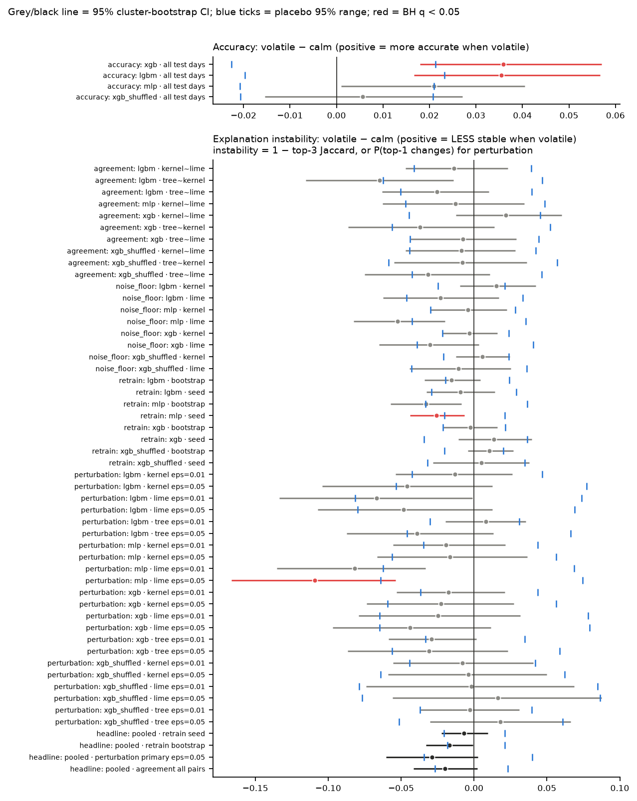

# Can you trust the explanation? A crypto XAI audit

[](https://www.python.org/downloads/)
[](docs/test_cases.md)
[](LICENSE)

**An audit of whether SHAP and LIME explanations of crypto next-day direction models agree, stay
stable, and get worse in volatile markets.** Arushi Nirmal, San José State University (CS 180,
Fall 2026). Paper: [`report/report.pdf`](report/report.pdf).

<p align="center">
  
  <br><em>Volatile − calm difference for all 56 tests (95% CIs; blue ticks = placebo range; red = significant
  after Benjamini–Hochberg). Lower panel: positive = less stable in volatile markets.</em>
</p>

**Findings at a glance**

* **The models barely beat a coin flip:** accuracy 0.512 (XGBoost), 0.512 (LightGBM) and 0.507
  (MLP), vs 0.502 for a shuffled-label control. There is a small edge only in volatile regimes.
* **Explanations are fragile:** LIME agrees with itself at only 0.638 (top-3 Jaccard). TreeSHAP,
  which has zero explainer noise, keeps a top-3 Jaccard of just 0.624 across retraining seeds.
  The no-skill control is just as stable.
* **Volatility does not make it worse:** none of 52 explanation-instability tests is
  significantly higher in volatile regimes. The only robust regime effect is in accuracy.

## What this project is

Many crypto-forecasting papers train a model and then show a SHAP or LIME plot that says which
indicators "drive" the price. This project checks whether those explanations can be trusted.
It trains standard next-day direction models for five coins (BTC, ETH, ADA, LINK, LTC), explains
them with four methods (TreeSHAP, KernelSHAP, LIME, permutation importance), and audits how
consistent the explanations are. Every instability number is compared with two baselines:

* **the explainer's own noise floor**: the same model and input, explained again with a new seed;
* **a shuffled-label control model** (`xgb_shuffled`): XGBoost trained on randomly permuted
  labels, so it has no skill by construction.

## Research question

Can SHAP/LIME feature-importance explanations of crypto next-day direction models be trusted?

* **(a) Agreement:** do the methods name the same top drivers?
* **(b) Retraining stability:** do the drivers survive a new random seed or a block-bootstrap resample?
* **(c) Perturbation stability:** do they survive a tiny input nudge (1% or 5% of a std)?
* **(d) Key question:** is the instability worse in high-volatility regimes than in calm ones?

## Key results in detail

All numbers come from `results/tables/`. Accuracy is pooled over 9835 out-of-sample days per
model, and the explanation results over 550 explained days (310 calm, 240 volatile).

* **The models barely beat a coin flip.** Accuracy is 0.512 (XGBoost), 0.512 (LightGBM) and
  0.507 (MLP), against 0.502 for the shuffled-label control and 0.504 for "always up". The small
  edge is only in volatile regimes: XGBoost 0.538 vs 0.502 when calm.
* **The explainers disagree.** TreeSHAP and KernelSHAP share 0.686 of their top-3 features
  (XGBoost, Jaccard). LIME shares 0.324 with TreeSHAP, and only 0.638 with *itself* across
  seeds. Two random rankings would share 0.164.
* **Retraining changes the explanation.** TreeSHAP has zero explainer noise, yet its top-3
  Jaccard across 6 seeds is 0.624, and across block bootstraps 0.312. The no-skill control is
  about as stable (0.593), so stability is not evidence of learning.
* **Small nudges change the top driver.** At 5% of a std, the TreeSHAP top-1 feature changes for
  0.280 of points, while the predicted class flips for 0.136.
* **Key question, a null result:** none of the 52 explanation tests is significantly *worse* in
  volatile regimes after Benjamini–Hochberg correction. The two significant explanation
  differences (both MLP) show *more* stability when volatile. The only robust regime effect is
  in accuracy.

Full write-up: [`report/report.pdf`](report/report.pdf). One-page version:
[`docs/results_summary.md`](docs/results_summary.md).

## Repository layout

```
crypto-xai-audit/
├── run_all.py                  entry point: experiments -> analysis (--quick, --analysis-only)
├── requirements.txt            minimum package versions
├── pytest.ini
├── LICENSE                     MIT (code); data keep Coin Metrics' terms
├── HANDOFF.md                  original design notes
├── data/raw/                   Coin Metrics Community CSVs: btc, eth, ada, link, ltc (see data/README.md)
├── src/xaiaudit/
│   ├── config.py               every setting + QUICK overrides
│   ├── data.py                 loader (refuses gaps/duplicates)
│   ├── features.py             12 causal features + next-day target
│   ├── validation.py           walk-forward folds, causal volatility regime
│   ├── models.py               xgb, lgbm, mlp
│   ├── explainers.py           TreeSHAP, KernelSHAP, LIME, permutation importance
│   ├── metrics.py              top-k Jaccard, Spearman, top-1 agreement, set stability
│   ├── experiments.py          the four audits + shuffled-label control, parallel over coins
│   └── analysis.py             CIs, permutation/placebo tests, BH correction, tables, figures
├── tests/                      25 pytest tests (see docs/test_cases.md)
├── results/                    outputs of the full run (see "Where the outputs land")
├── notebooks/run_pipeline.ipynb   Colab notebook
├── docs/
│   ├── 01_problem_statement.md    problem statement + literature-survey outline
│   ├── design.md                  UML class, sequence and data-flow diagrams; design decisions
│   ├── methods_and_metrics.md     plain-English + formula definitions of everything
│   ├── test_cases.md              test table with expected and actual results
│   ├── results_summary.md         one-page summary for the advisor
│   ├── presentation_script.md     10-minute recorded code-review script
│   ├── defense_prep.md            15 likely questions with answers
│   └── CS180-Proposal_Crypto_Explainability_Audit.pdf
└── report/
    ├── report.md, report.pdf      workshop-style paper
    ├── figures/                   copies of results/figures (made by build.sh)
    ├── build.sh                   pandoc + typst build
    └── check_numbers.py           checks every number in the report against results/
```

## Setup

Python 3.10–3.12 is recommended (tested on 3.12.15).

```bash
python3.12 -m venv .venv
source .venv/bin/activate
pip install -r requirements.txt
```

**lime workaround (Python 3.13+ only).** `pip install lime` can fail to build on Python 3.13.
If it does, install everything else, then copy the pure-Python `lime` package in by hand:

```bash
pip download --no-deps --no-binary :all: lime==0.2.0.1
tar xzf lime-0.2.0.1.tar.gz
cp -r lime-0.2.0.1/lime "$(python -c 'import site; print(site.getsitepackages()[0])')/"
```

To rebuild the PDF you also need pandoc and typst (`brew install pandoc typst`).

## Reproduce from a clean checkout

```bash
git clone https://github.com/arushiSH5-cyber/crypto-xai-audit.git
cd crypto-xai-audit
# create and activate the venv as above, then:
python -m pytest -q          # 25 tests
python run_all.py --quick    # smoke test: 2 coins, 2024+, writes results/quick/
python run_all.py            # full run: 5 coins x 11 folds x 4 models, writes results/
./report/build.sh            # optional: rebuild report/report.pdf
```

Measured runtimes (Apple-silicon laptop, 2 worker processes):

| Step | Time | Source |
|---|---|---|
| `pytest -q` | 30.7 s | `results/pytest_output.txt` |
| `run_all.py --quick` | 16.2 s (13.7 s experiments + 2.5 s analysis) | `results/reproduction_check.log` |
| `run_all.py` (full) | 310.3 s (272.6 s experiments + 37.6 s analysis) | `results/run_log.json` |

`python run_all.py --analysis-only` rebuilds the tables and figures from `results/cache/`
without re-running the experiments. All settings are in
[`src/xaiaudit/config.py`](src/xaiaudit/config.py). Every random draw is seeded, and two runs
give identical CSVs (test TC-20). On Colab, open
[`notebooks/run_pipeline.ipynb`](notebooks/run_pipeline.ipynb).

## Where the outputs land

| Path | Contents |
|---|---|
| `results/cache/*.csv` | Tidy rows from every audit: `predictions`, `agreement_local`, `agreement_global`, `global_importance`, `noise_floor`, `retrain_stability`, `retrain_top1`, `retrain_accuracy`, `perturbation`, `folds` |
| `results/cache/attributions.pkl` | Raw attribution arrays for every (coin, model, fold). About 9 MB, so it is **not committed**; `python run_all.py` recreates it |
| `results/tables/*.csv` and `*.md` | Summary tables: accuracy by regime/coin, agreement, noise floor, retraining, perturbation, excess over noise floor, global feature ranks, the 56 regime tests |
| `results/tables/key_numbers.json` | Headline counts (tests run, significant tests, random baselines, sample sizes) |
| `results/figures/fig1…fig7.png` | Accuracy, agreement heatmap, retraining, perturbation, volatile − calm forest plot, top-1 frequency, placebo nulls |
| `results/run_log.json` | Timings, package versions and the exact config used |
| `results/quick/` | Same structure for `--quick` (not committed) |

## Data source and attribution

Price and volume data are from **Coin Metrics Community Data**
(<https://github.com/coinmetrics/data>, files `csv/<asset>.csv`), columns `PriceUSD` and
`volume_reported_spot_usd_1d`, 2017-12-01 to 2026-05-22. Data © Coin Metrics, used with
attribution. Coin Metrics publishes Community Data under its own license (Creative Commons
Attribution-NonCommercial, per that repository). Check those terms before redistributing the
data or using it outside academic work. The data are close-only (no open/high/low). LTC
replaces the planned SOL because SOL's volume history is missing in this dataset.

## License

The **code and documentation** are released under the [MIT License](LICENSE).

The **data** in `data/raw/` are Coin Metrics Community Data. They keep Coin Metrics' own license
terms and are not covered by the MIT license. See [`data/README.md`](data/README.md).

## Timeline vs proposal

| Week | Proposal milestone | Delivered in | Differences from the proposal |
|---|---|---|---|
| 1 | Background reading, problem statement | `docs/01_problem_statement.md` | Added Krishna et al. (2022), missing from the reading list |
| 2 | Public data for BTC, ETH + 2–3 mid caps; standard features | `data/raw/`, `src/xaiaudit/data.py`, `features.py` | Coin Metrics Community data (close-only, so no OHLC features). **LTC instead of SOL** (SOL volume missing) |
| 3 | Strictly time-ordered validation harness | `validation.py`, `tests/test_validation.py`, `tests/test_features.py` | — |
| 4 | Train XGBoost, LightGBM, small NN; accuracy per regime | `models.py`, `results/tables/accuracy_by_regime.*`, `fig1` | The small NN is scikit-learn's `MLPClassifier`. Added the shuffled-label control |
| 5 | TreeSHAP, KernelSHAP, LIME, permutation importance; UML | `explainers.py`, `docs/design.md` | — |
| 6 | Cross-method agreement (Jaccard, rank correlation) | `experiments.py`, `agreement_local_summary.*`, `agreement_global_summary.*`, `fig2` | — |
| 7 | Stability under retraining (seeds, bootstrap) | `retrain_summary.*`, `fig3`, `fig6` | Moving-block bootstrap (30-day blocks), to respect time dependence |
| 8 | Stability under perturbation | `perturbation_summary.*`, `perturbation_excess_over_noise_floor.*`, `fig4` | Perturbed inputs keep `macd_hist = macd − macd_signal` and volatilities ≥ 0 |
| 9 | Volatility-regime comparison (key question) | `analysis.py`, `regime_tests.*`, `fig5` | Added cluster-bootstrap CIs, within-fold permutation tests, BH correction |
| 10 | Consolidate results, tables and figures | `results/tables/`, `results/figures/`, `docs/results_summary.md` | — |
| 11 | Repeated-run noise floor | `noise_floor_summary.*`, `fig4`, `fig7` | Used as a baseline in every audit, not only as an appendix. Added a placebo regime test |
| 12 | Test cases; clean-checkout reproduction | `tests/`, `docs/test_cases.md` | — |
| 13 | Code and data available (repo, gDrive, Colab) | this README, `requirements.txt`, `results/run_log.json`, `notebooks/run_pipeline.ipynb` | GitHub repo is private for now; gDrive upload still to do |
| 14 | Recorded code review | `docs/presentation_script.md`, `docs/defense_prep.md` | Recording still to do |
| 15 | Report / workshop-paper draft | `report/report.md`, `report/report.pdf` | — |
