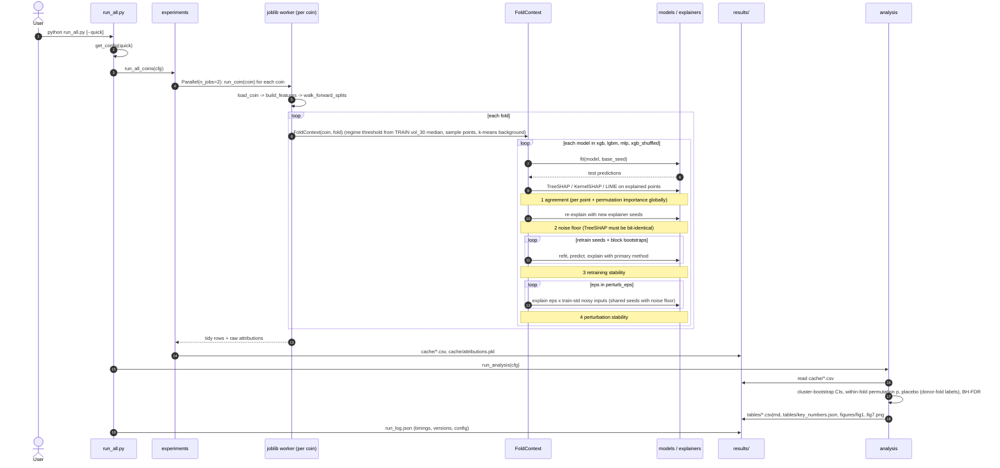

# System design

The pipeline is a set of small, mostly functional modules under `src/xaiaudit/`, plus
two classes that hold per-fold state. Every setting lives in `config.py`, and the
entry point is `run_all.py`.

## Module / class diagram (UML)

## Sequence diagram: one full run

## Key design decisions

| Decision | Why |
|---|---|
| Expanding walk-forward, refit every 182 days, 1-day embargo | No shuffling, no future rows in training, which avoids the leakage common in this literature. |
| Regime = trailing `vol_30` above the *training-window* median | The label is known on the prediction day (no look-ahead in the regime definition). |
| Explained points sampled half calm / half volatile per fold | Both regimes are represented in every fold, so regime comparisons are within-fold. |
| Explainer seeds shared between noise-floor rep *r* and perturbation rep *r* | Common random numbers: the perturbation-minus-noise-floor gap isolates the input change. |
| Perturbation recomputes `macd_hist = macd − macd_signal` and clips volatilities at 0 | Perturbed inputs stay on the feature manifold. |
| Shuffled-label `xgb_shuffled` control | Shows how stable or unstable explanations of a skill-less model are. |
| Cluster (coin × fold) bootstrap and within-fold permutation | Points in a fold share a model and a market period, so they are not independent. |
| Placebo = regime sequence borrowed from a different fold (another half-year) | Realistic run lengths and proportions, but no link to the volatility on the actual dates. A circular shift was rejected because regimes persist for months, so the shifted labels stayed close to the real ones. |
| CRC-based seeds (`_seed(base_seed, coin, fold, tag)`) | Python's `hash()` is salted per process. CRC gives identical draws in every worker and on every run. |
