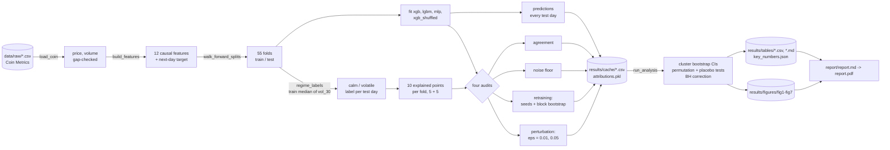
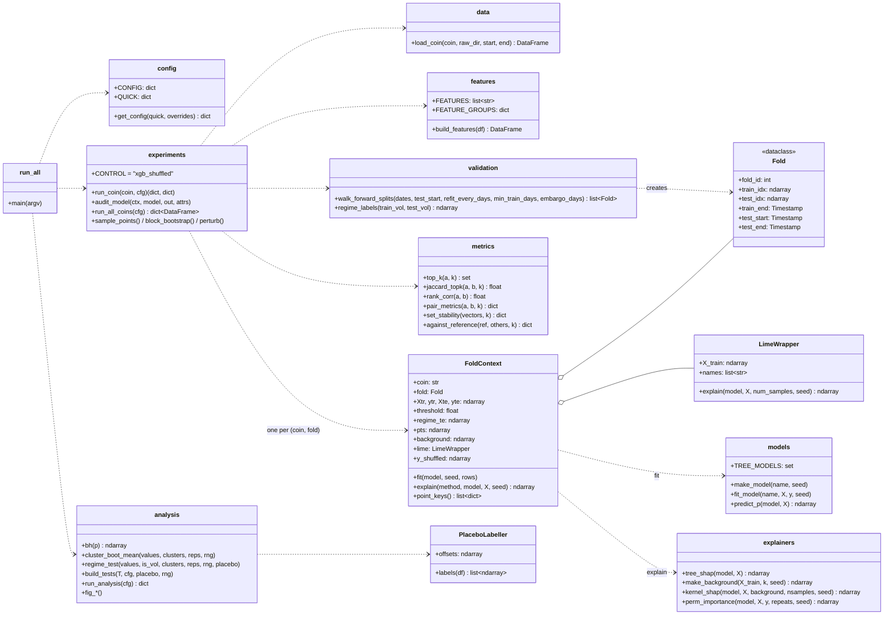
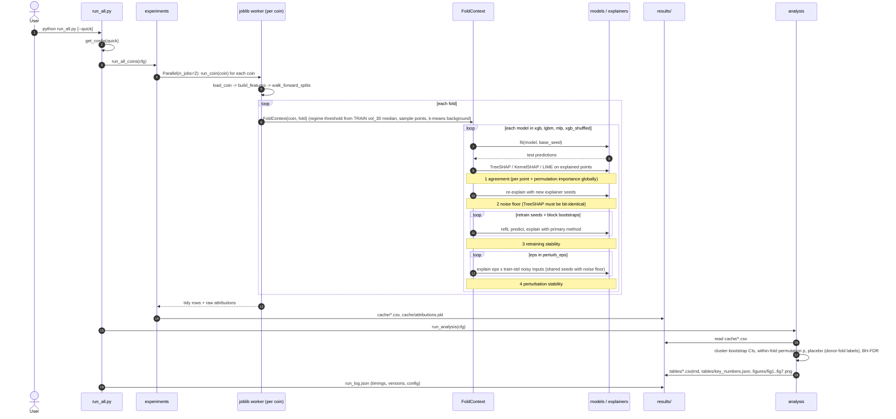

# System design

The pipeline is a set of small, mostly functional modules under `src/xaiaudit/`, plus
four small classes that hold state (`Fold`, `FoldContext`, `LimeWrapper`, `PlaceboLabeller`). Every setting lives in `config.py`, and the entry point is
`run_all.py`. Formulas for everything below are in `docs/methods_and_metrics.md`.

## Modules

| Module | What it does |
|---|---|
| `config.py` | One dictionary with every setting (coins, dates, fold length, seeds, sample sizes, repetitions), plus `QUICK` overrides for the smoke test. `get_config(quick, overrides)` returns a copy. |
| `data.py` | `load_coin` reads one Coin Metrics CSV, keeps price and volume, and **raises an error** on duplicate or missing days instead of filling them. |
| `features.py` | `build_features` makes the 12 causal features and the next-day target. `FEATURE_GROUPS` lists related features. |
| `validation.py` | `walk_forward_splits` builds the expanding-window folds (`Fold` dataclass). `regime_labels` labels test days calm/volatile against the training median of `vol_30`. |
| `models.py` | `make_model` / `fit_model` / `predict_p` for XGBoost, LightGBM and the MLP. The seed controls all model randomness. |
| `explainers.py` | Thin wrappers that return an `(n_points, 12)` array: `tree_shap`, `kernel_shap` (with a k-means background), `LimeWrapper.explain`, and `perm_importance` (global). |
| `metrics.py` | Top-k sets, Jaccard, Spearman on \|attr\|, top-1 agreement, `set_stability` (many explanations of one point) and `against_reference` (perturbed vs original). |
| `experiments.py` | `FoldContext` holds one fold's data, regime labels, explained points, KernelSHAP background and LIME explainer. `audit_model` runs the four audits for one model. `run_coin` loops over folds and models. `run_all_coins` runs coins in parallel (joblib) and writes `results/cache/`. |
| `analysis.py` | Reads the cache. Computes cluster-bootstrap CIs, the 56 volatile-vs-calm tests (within-fold permutation, placebo, BH), accuracy/AUC per regime, and writes `results/tables/` and `results/figures/`. |
| `run_all.py` | Command-line entry point (`--quick`, `--analysis-only`, `--results-dir`). Times each stage and writes `run_log.json`. |

## Data-flow diagram

## Module / class diagram (UML)

## Sequence diagram: one full run

## Key design decisions

| Decision | Why |
|---|---|
| **Expanding walk-forward validation**: refit every 182 days, test from 2021-01-01, 1-day embargo, no shuffling | Shuffled k-fold on time series lets the model train on days *after* the ones it is tested on, which inflates accuracy. That leakage is common in this literature. Walk-forward only ever trains on the past, like a real forecaster, and refitting every 6 months lets the model use new data. |
| **Causal regime threshold**: a test day is volatile if its `vol_30` exceeds the median `vol_30` of the fold's *training* window | A threshold computed on the whole sample (or the test period) would use future volatility to label past days. The training median is known on the prediction day, so the regime is something a forecaster could actually observe. Tested by TC-06 and TC-07. |
| **Shuffled-label control** (`xgb_shuffled`) | Accuracy near 0.5 raises the question "is there anything to explain?". A model trained on permuted labels has no skill by construction. If its explanations are as agreeable and as stable as the real models', then agreement and stability can't be read as evidence of real signal. |
| **Explainer noise floor**: KernelSHAP and LIME re-run with new seeds on the same model and input; TreeSHAP asserted bit-identical | Stochastic explainers disagree with themselves. Without a noise floor, explainer randomness would be counted as model instability. Every retraining and perturbation number is compared with this floor. |
| **Moving-block bootstrap** (30-day blocks) for retraining | Daily returns and especially the features (rolling windows, EMAs) are autocorrelated. An ordinary bootstrap would break that structure. Resampling contiguous 30-day blocks keeps short-range dependence, so each resample looks like a plausible alternative history (Künsch 1989). |
| Explained points sampled half calm / half volatile per fold | Both regimes appear in every fold where possible, so regime comparisons are made within a fold, not across different years. |
| Explainer seeds shared between noise-floor rep *r* and perturbation rep *r* | Common random numbers: the perturbation-minus-noise-floor gap isolates the input change. |
| Perturbation recomputes `macd_hist = macd − macd_signal` and clips volatilities at 0 | Perturbed inputs stay valid feature vectors (on the feature manifold). |
| Cluster (coin × fold) bootstrap and within-fold permutation | Points in a fold share a model and a market period, so they are not independent. |
| Placebo = regime sequence borrowed from a different fold (another half-year) | Realistic run lengths and proportions, but no link to the volatility on the actual dates. A circular shift was rejected because regimes persist for months, so shifted labels stayed close to the real ones. |
| CRC-based seeds (`_seed(base_seed, coin, fold, tag)`) | Python's `hash()` is salted per process. CRC gives identical draws in every worker and on every run. |
