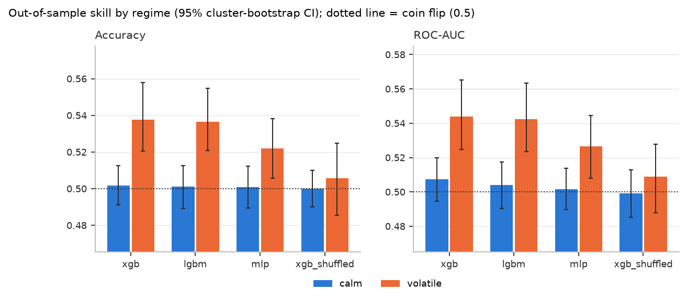
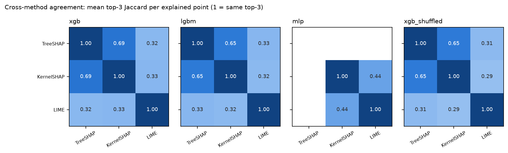
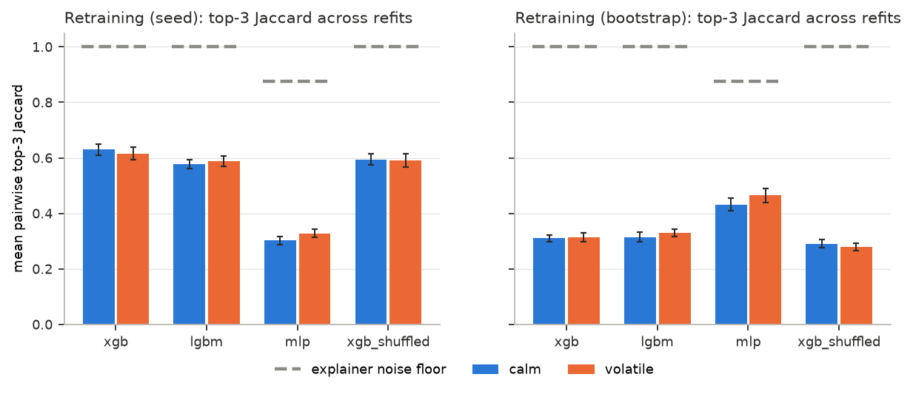
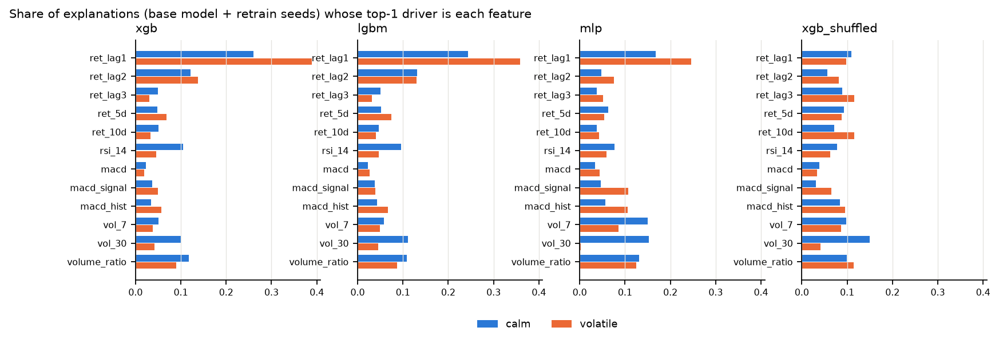
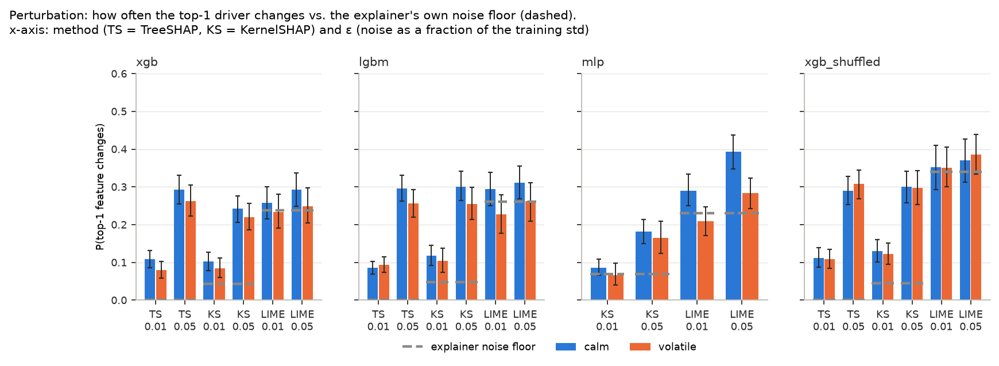
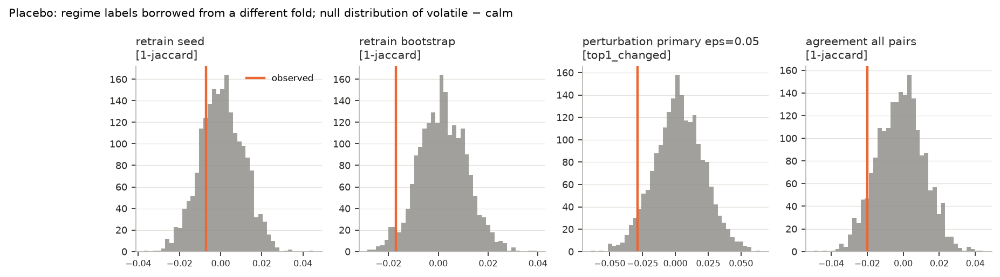

# Abstract

Applied cryptocurrency-forecasting papers often present SHAP or LIME feature importances as facts
about the market. We test whether such explanations can be trusted. XGBoost, LightGBM and a small
MLP predict next-day direction for BTC, ETH, ADA, LINK and LTC under walk-forward validation
(55 folds, 9835 test days per model). On 550 explained test days we measure cross-method
agreement, stability under retraining, stability under small input perturbations, and whether
instability differs between high- and low-volatility regimes. Every number is compared with the
explainer's own seed-to-seed noise floor and with a shuffled-label control model that has no
skill. The models barely beat a coin flip (accuracy 0.507–0.512 vs 0.502 for the control), with
a small edge only in volatile regimes. Explanations are fragile. LIME shares about a third of
its top-3 features with SHAP and 0.638 with itself. TreeSHAP, which has zero explainer noise,
keeps a top-3 Jaccard of only 0.624 across retraining seeds, and a 5% input nudge changes its
top feature for 0.280 of points. The no-skill control is equally stable. On the key question
we find a clear null: no explanation-instability measure is significantly worse in volatile
regimes (0 of 52 tests after Benjamini–Hochberg correction).

# 1 Introduction

Machine-learning models for cryptocurrency prices are now common, and many papers pair them with
post-hoc explainers such as SHAP [1] or LIME [4] to report which indicators "drive" the
predictions [7]. Such a report carries an implicit claim: that the explanation describes
something stable about the model, and through the model, about the market. Both links are weak.
Daily crypto direction is close to unpredictable, so a model may have little real structure to
explain. Explanation methods are known to be sensitive to random seeds, sampling, correlated
features and small input changes [2, 3, 5, 8], and different methods often disagree with each
other [10].

This project asks how far the feature-importance story can be trusted in this setting, and
under what conditions it breaks down:

* **RQ-a (agreement).** Do TreeSHAP, KernelSHAP, LIME and permutation importance agree on the top drivers?
* **RQ-b (retraining).** Are the drivers stable when the model is retrained with new seeds or on block-bootstrap resamples?
* **RQ-c (perturbation).** Are they stable when the inputs are perturbed slightly?
* **RQ-d (regimes, the key question).** Is the instability worse in high-volatility regimes than in calm ones?

**Contributions.**

1. A leakage-free audit pipeline: causal features (tested by truncation), expanding walk-forward
   validation, and a regime label computed only from training data.
2. Four audits run on the *same* 550 explained points, so agreement, retraining and perturbation
   results are directly comparable.
3. Two explicit baselines for every instability number: the explainer's own **noise floor**
   (common random numbers make the comparison exact) and a **shuffled-label control model**.
4. A careful regime comparison: cluster-bootstrap CIs, within-fold permutation tests, a placebo
   relabelling test, and Benjamini–Hochberg correction over 56 tests.
5. A clear answer: explanations of these models are fragile, the fragility is the same for a
   no-skill model, and it is *not* worse in volatile regimes.

# 2 Related Work

**Post-hoc attribution methods.** Ribeiro et al. [4] introduced LIME, which fits a weighted linear
surrogate to random perturbations around a point. Lundberg and Lee [1] unified attribution
methods under Shapley values and proposed KernelSHAP, a sampling-based estimator. TreeSHAP [11]
computes Shapley values exactly for tree ensembles. Permutation importance [16, 9] measures the
global drop in performance when one feature is shuffled. Molnar [9] surveys these methods and
their caveats, especially with correlated features.

**Instability and fragility.** Alvarez-Melis and Jaakkola [2] showed that LIME and SHAP
explanations can change sharply under small input changes. Ghorbani et al. [8] showed that
explanations of neural networks are fragile under imperceptible perturbations. Slack et al. [3]
built models that deliberately fool LIME and SHAP. Zhou, Hooker and Wang [5] traced LIME's
instability to its random sampling and proposed S-LIME, which chooses the sample size by
hypothesis testing so that explanations stabilise.

**The disagreement problem.** Krishna et al. [10] showed that practitioners routinely see
explanation methods disagree on the top features of the same prediction. They defined
top-k feature agreement, rank agreement and related metrics. Our top-3 Jaccard and Spearman
metrics follow that framing.

**ML for crypto prediction.** Gradient-boosted trees [6, 15] and small neural networks are standard
tools in applied crypto forecasting. Pinky and Akula [7] is a representative example of work that
reports model accuracy together with feature-importance analysis. We found no study that measures
agreement, retraining stability and perturbation stability *together*, against a noise floor and
a no-skill control, split by volatility regime, for crypto direction models.

# 3 Data and Features

**Data.** Daily Coin Metrics Community Data [14] for BTC, ETH, ADA, LINK and LTC: `PriceUSD`
(a reference price at 00:00 UTC) and `volume_reported_spot_usd_1d`, from 2017-12-01 to
2026-05-22. The loader refuses gaps and duplicates rather than filling them. The data are
close-only (no open/high/low). LTC replaces the planned SOL because SOL's volume history is
missing in this dataset.

**Features.** Twelve features use information up to the end of day *t* only: log returns at lags
1–3; 5- and 10-day cumulative returns; Wilder RSI(14); MACD, its signal line and histogram (each
divided by price); 7- and 30-day realised volatility; and log volume relative to its 30-day mean.
The MACD trio is exactly collinear (`macd_hist = macd − macd_signal`). We keep it on purpose,
because correlated features are common in practice and make attribution methods split credit.
The **target** is 1 if the next day's log return is positive. After 60 warm-up rows, each coin
has 3034 rows. Formulas are in `docs/methods_and_metrics.md`. Causality is tested by rebuilding
the features on truncated series and by injecting a future price shock (tests TC-01 to TC-04).

# 4 Methodology

**Walk-forward validation.** Expanding window. 182-day test blocks start on 2021-01-01. Each fold
trains on every row dated before the block, minus a 1-day embargo, and needs at least 730
training rows. Nothing is shuffled (TC-05).

**Volatility regime.** A test day is *volatile* if its trailing 30-day volatility (`vol_30`)
exceeds the median `vol_30` of the fold's **training** window; otherwise it is *calm*. The
threshold uses training data only, so the label is known on the prediction day (TC-06, TC-07).

**Models.** XGBoost (200 trees, depth 3) and LightGBM (200 trees, 8 leaves), both with 0.8 row
and column subsampling, and an MLP (32–16 hidden units, early stopping, standardised inputs).
The **control** `xgb_shuffled` is the same XGBoost trained on randomly permuted training labels,
so it has no skill by construction.

**Explainers.** *TreeSHAP* (path-dependent, log-odds; tree models only). *KernelSHAP* (logit link,
20-centre k-means background, 200 coalition samples; the shap default `l1_reg = num_features(10)`
keeps 10 of 12 features non-zero). *LIME* (quartile discretisation, 1000 samples, probability
space). *Permutation importance* (drop in ROC-AUC on the test fold, 10 repeats; global only). We
compare rankings of |attribution|, never raw values, because the output spaces differ.

**Metrics.** Our primary metric is **top-3 Jaccard**: the overlap of the two sets of three
features with the largest |attribution| (1 = same set). We also use Spearman correlation of |attr|
over all 12 features, **top-1 agreement**, the **top-1 change rate** (how often the top feature
differs from a reference explanation), and the **prediction flip rate** (how often the predicted
class changes). As calibration, two *random* rankings of 12 features have expected top-3 Jaccard
0.164 and top-1 agreement 0.083.

**Audits.** (a) *Agreement*: every pair of explainers on the same point, and globally permutation
importance vs mean |attribution| per fold. (b) *Noise floor*: KernelSHAP and LIME re-run with new
seeds on the identical model and input; TreeSHAP is re-run and asserted bit-identical.
(c) *Retraining*: refits with 5 new seeds and on 5 moving-block bootstraps (30-day blocks) of the
training rows [13], each re-explained with the model's primary method (TreeSHAP for trees,
KernelSHAP for the MLP). (d) *Perturbation*: Gaussian noise of ε × (training std) for
ε ∈ {0.01, 0.05}, with `macd_hist` recomputed and volatilities kept ≥ 0. Perturbation repeat *r*
reuses the explainer seed of noise-floor repeat *r*, so the gap between the two is caused only by
the input change.

**Statistics.** Points within a (coin, fold) share a model and a market period, so we treat the
55 (coin, fold) pairs as **clusters**. CIs are 95% **cluster bootstraps**. Each volatile − calm
difference is tested with a **within-cluster permutation test**. Every explanation metric is
oriented as *instability* (1 − Jaccard, or the top-1 change rate), so a positive difference
means "less stable when volatile". **Benjamini–Hochberg** [12] controls the false discovery rate
over all 56 tests. In the **placebo test**, each fold receives the regime sequence of a
*different*, randomly chosen fold, which gives realistic but meaningless labels. The resulting
null distribution shows how large a regime gap can appear by chance.

# 5 Experimental Setup

| Item | Value |
|---|---|
| Coins / rows per coin | 5 / 3034 |
| Walk-forward folds | 11 per coin, 55 total; training 1066–2886 rows; test blocks 147–182 days |
| Out-of-sample days per model | 9835 (1967 per coin); 0.293 of them volatile |
| Models | xgb, lgbm, mlp + xgb_shuffled control, all fit at `base_seed = 0` |
| Explained points | 10 per (coin, fold) → 550 (310 calm, 240 volatile); 7 of the 55 folds had no volatile test day |
| Noise floor | 3 extra seeds per stochastic explainer |
| Retraining | 5 seeds + 5 moving-block bootstraps (block 30) per model and fold |
| Perturbation | ε ∈ {0.01, 0.05}; 10 repeats (TreeSHAP), 3 repeats (KernelSHAP, LIME) |
| Statistics | 2000 cluster-bootstrap resamples, 2000 permutations, 2000 placebo relabellings; 56 tests |
| Software | Python 3.12.15, numpy 2.5.4, pandas 3.0.6, scikit-learn 1.9.1, xgboost 3.4.1, lightgbm 4.7.0, shap 0.54.1, lime 0.2.0.1 |
| Runtime | 310.3 s for the full run on an Apple-silicon laptop with 2 worker processes |

Table: Experimental setup. Sources: `results/run_log.json`, `results/tables/folds.csv`, `key_numbers.json`.

All randomness derives from `base_seed` through CRC-hashed task keys. Two runs give identical CSVs
(test TC-20), and a run from a fresh clone reproduced every committed result file byte-for-byte.
The full run was well under the 60-minute budget, so all sample sizes are the configured
defaults. All 25 tests pass.

# 6 Results

Every stability table below lists the model's out-of-sample accuracy next to it: xgb 0.512,
lgbm 0.512, mlp 0.507, control 0.502.

## 6.1 Predictive performance

{width=95%}

| model | accuracy | 95% CI | AUC | calm acc. | volatile acc. | volatile − calm (q) |
|---|---|---|---|---|---|---|
| xgb | 0.512 | 0.502–0.523 | 0.520 | 0.502 | 0.538 | +0.036 (0.028) |
| lgbm | 0.512 | 0.501–0.522 | 0.517 | 0.501 | 0.537 | +0.035 (0.028) |
| mlp | 0.507 | 0.498–0.517 | 0.509 | 0.501 | 0.522 | +0.021 (0.150) |
| xgb_shuffled (control) | 0.502 | 0.493–0.511 | 0.502 | 0.500 | 0.506 | +0.006 (0.758) |

Table: Accuracy over 9835 test days per model. "Always predict up" scores 0.504 overall (0.506 calm, 0.496 volatile). Sources: `accuracy_by_regime.csv`, `regime_tests.csv`.

The models are barely better than a coin flip. The MLP's CI includes 0.5, and the tree models'
CIs start at 0.502 and 0.501. In **calm** regimes no model beats the control: all score
0.500–0.502. In **volatile** regimes XGBoost and LightGBM reach 0.538 and 0.537 (AUC 0.544 and
0.542), ahead of the control (0.506) and "always up" (0.496). This difference survives BH
correction, and it lies outside the placebo 95% range (xgb: −0.023 to 0.021). It is not
universal: for LINK, XGBoost scores 0.498 overall and 0.492 in volatile regimes
(`accuracy_by_coin.csv`). **Every explanation below therefore describes a model that is mostly
fitting noise.** That is typical for next-day crypto models, and it is exactly when
feature-importance stories are most tempting and least justified.

## 6.2 Cross-method agreement

{width=100%}

| model (acc.) | TreeSHAP–KernelSHAP | TreeSHAP–LIME | KernelSHAP–LIME | LIME vs itself (noise floor) |
|---|---|---|---|---|
| xgb (0.512) | 0.686 (0.742) | 0.324 (0.331) | 0.329 (0.355) | 0.638 |
| lgbm (0.512) | 0.653 (0.747) | 0.328 (0.335) | 0.319 (0.324) | 0.631 |
| mlp (0.507) | – | – | 0.438 (0.453) | 0.678 |
| xgb_shuffled (0.502) | 0.651 (0.740) | 0.314 (0.276) | 0.288 (0.269) | 0.619 |

Table: Per-point top-3 Jaccard, with top-1 agreement in brackets (550 points per cell). Last column: LIME's top-3 Jaccard against itself across seeds. Sources: `agreement_local_summary.csv`, `noise_floor_summary.csv`.

TreeSHAP and KernelSHAP share about two-thirds of their top-3 features. Both are Shapley-value
methods, but path-dependent TreeSHAP and interventional KernelSHAP treat correlated features
differently. LIME agrees with either SHAP variant at about 0.32: above the random baseline
(0.164), but far below SHAP–SHAP. **Part of that gap is LIME's own noise**: run on the identical
model and point with a new seed, LIME agrees with itself at only 0.619–0.678. This is the
instability S-LIME [5] was designed to fix.

*Globally*, permutation importance agrees poorly with mean |TreeSHAP|: per-fold top-3 Jaccard
0.267 (xgb) and 0.278 (lgbm), Spearman 0.286 and 0.279. For the MLP, Spearman with mean
|KernelSHAP| is 0.101 (`agreement_global_summary.csv`). This is what near-zero skill predicts.
Permutation importance measures a feature's effect on *accuracy*, which is close to zero for
every feature, while SHAP measures its effect on the *output*.

**Control comparison.** The no-skill control agrees about as much as the real models
(TreeSHAP–KernelSHAP 0.651 vs 0.686 for xgb). Agreement between explainers is not evidence that
the model learned anything.

## 6.3 Retraining stability

{width=95%}

| model (acc.), method | seeds: Jaccard [95% CI] | seeds: top-1 same | bootstraps: Jaccard [95% CI] | noise floor | class flips (seeds / bootstraps) |
|---|---|---|---|---|---|
| xgb (0.512), TreeSHAP | 0.624 [0.607, 0.641] | 0.664 | 0.312 [0.301, 0.323] | 1.000 | 0.128 / 0.280 |
| lgbm (0.512), TreeSHAP | 0.582 [0.569, 0.595] | 0.662 | 0.320 [0.309, 0.332] | 1.000 | 0.150 / 0.279 |
| mlp (0.507), KernelSHAP | 0.313 [0.302, 0.325] | 0.284 | 0.446 [0.425, 0.467] | 0.876 | 0.412 / 0.280 |
| xgb_shuffled (0.502), TreeSHAP | 0.593 [0.577, 0.609] | 0.633 | 0.285 [0.274, 0.297] | 1.000 | 0.140 / 0.288 |

Table: Mean pairwise stability among the base model and 5 refits (550 points each). Noise floor = the same explainer's top-3 Jaccard against itself on an unchanged model. Class flips = share of refits whose predicted class differs from the base model's. Source: `retrain_summary.csv`.

Changing only XGBoost's random seed leaves a top-3 Jaccard of 0.624. The top-1 feature agrees in
only 0.664 of model pairs, and across 6 models a point has on average 1.936 distinct top-1
features. TreeSHAP's noise floor is exactly 1, so **all of this is model sensitivity, not
explainer noise**. Block-bootstrap resampling is more disruptive still: Jaccard drops to 0.312,
not far above the random baseline of 0.164, and the predicted class flips in 0.280 of refits.
For the MLP, the KernelSHAP noise floor is 0.876, but retraining stability is 0.313 (seeds) and
0.446 (bootstraps), far below it. Accuracy barely moves across refits: XGBoost's pooled accuracy
across seeds ranges from 0.509 to 0.516.

**Control comparison.** The control is nearly as stable as the real models (0.593 vs 0.624
across seeds). There is one sign of learning, at the *global* level. Across folds, the real
XGBoost puts `ret_lag1` in its TreeSHAP top-3 in 0.927 of folds, while the control's most
frequent top-3 feature (`ret_5d`) reaches only 0.418 (`global_feature_ranks.csv`; see Figure 4).

{width=100%}

## 6.4 Perturbation stability

{width=100%}

| model (acc.) | method | ε = 0.01 | ε = 0.05 | noise floor | excess at ε = 0.05 [95% CI] | prediction flips (ε = 0.05) |
|---|---|---|---|---|---|---|
| xgb (0.512) | TreeSHAP | 0.096 | 0.280 | 0.000 | 0.280 | 0.136 |
| xgb (0.512) | KernelSHAP | 0.095 | 0.232 | 0.043 | 0.189 [0.165, 0.214] | 0.133 |
| xgb (0.512) | LIME | 0.247 | 0.273 | 0.238 | 0.036 [0.021, 0.052] | 0.133 |
| lgbm (0.512) | TreeSHAP | 0.089 | 0.278 | 0.000 | 0.278 | 0.142 |
| mlp (0.507) | KernelSHAP | 0.078 | 0.175 | 0.068 | 0.106 [0.081, 0.130] | 0.059 |
| mlp (0.507) | LIME | 0.255 | 0.345 | 0.231 | 0.114 [0.091, 0.136] | 0.059 |
| xgb_shuffled (0.502) | TreeSHAP | 0.110 | 0.298 | 0.000 | 0.298 | 0.145 |
| xgb_shuffled (0.502) | KernelSHAP | 0.127 | 0.299 | 0.044 | 0.255 [0.222, 0.290] | 0.148 |
| xgb_shuffled (0.502) | LIME | 0.351 | 0.377 | 0.339 | 0.038 [0.018, 0.056] | 0.148 |

Table: P(top-1 feature changes) relative to the unperturbed explanation (550 points each). The excess over the noise floor is paired per point. Sources: `perturbation_summary.csv`, `perturbation_excess_over_noise_floor.csv`.

Gaussian noise of 5% of each feature's training standard deviation changes the TreeSHAP top-1
feature for 0.280 (xgb) and 0.278 (lgbm) of points. Even 1% changes it for 0.096 and 0.089. For
the tree models, the explanation changes about twice as often as the predicted class does (0.136
at ε = 0.05). Measured against the **noise floor**: for KernelSHAP the floor is low and the excess
is real (0.189 for xgb at ε = 0.05). For LIME, most of the change is noise. At ε = 0.01 its
excess is 0.010 (xgb) and 0.005 [−0.002, 0.013] (lgbm), so a LIME top-1 change at that size is
almost entirely sampling noise. **Control comparison:** the control is as fragile as the real
models (TreeSHAP 0.298 at ε = 0.05).

## 6.5 Volatility-regime comparison (the key question)

{width=92%}

| test (pooled models) | calm | volatile | volatile − calm [95% CI] | p (perm.) | q (BH) | placebo 95% range | p (placebo) |
|---|---|---|---|---|---|---|---|
| retrain, seeds | 0.497 | 0.490 | −0.007 [−0.022, 0.009] | 0.492 | 0.758 | −0.021 to 0.021 | 0.507 |
| retrain, bootstraps | 0.648 | 0.631 | −0.017 [−0.033, −0.001] | 0.064 | 0.258 | −0.018 to 0.021 | 0.093 |
| perturb., ε = 0.05 | 0.257 | 0.228 | −0.029 [−0.060, 0.003] | 0.029 | 0.150 | −0.034 to 0.040 | 0.133 |
| agreement | 0.569 | 0.549 | −0.020 [−0.041, 0.002] | 0.102 | 0.336 | −0.027 to 0.023 | 0.130 |

Table: Pooled headline regime tests over xgb, lgbm and mlp. Instability = 1 − top-3 Jaccard (retraining, agreement) or P(top-1 changes) (perturbation, primary explainer). Rows: 930 calm / 720 volatile point-model pairs; agreement 2170 / 1680 point-pairs. Source: `regime_tests.csv`.

Of the 56 tests, 12 have a raw permutation p < 0.05, and 4 survive BH correction at q < 0.05
(`key_numbers.json`):

* accuracy, xgb: +0.036 (q = 0.028);
* accuracy, lgbm: +0.035 (q = 0.028);
* retraining (seeds), mlp: 1 − Jaccard −0.026 (q = 0.028), i.e. **more** stable when volatile;
* perturbation, mlp/LIME, ε = 0.05: top-1 change rate −0.109 (q = 0.028), i.e. **more** stable when volatile.

**No explanation-instability measure is significantly higher in volatile regimes.** Only 9 of the
52 explanation differences are positive at all. All four pooled headline differences are slightly
negative and fall inside their placebo 95% ranges. The two significant explanation differences
(both MLP) point *against* the hypothesis. The control's regime differences are all
non-significant (smallest q = 0.570). The only robust regime effect is in **accuracy**, not in
explanation stability.

## 6.6 Noise floor and placebo

| model | KernelSHAP vs itself: Jaccard | KernelSHAP: top-1 change rate | LIME vs itself: Jaccard | LIME: top-1 change rate | TreeSHAP |
|---|---|---|---|---|---|
| xgb | 0.938 | 0.043 | 0.638 | 0.238 | 1.000 / 0.000 |
| lgbm | 0.922 | 0.047 | 0.631 | 0.261 | 1.000 / 0.000 |
| mlp | 0.876 | 0.068 | 0.678 | 0.231 | – |
| xgb_shuffled | 0.945 | 0.044 | 0.619 | 0.339 | 1.000 / 0.000 |

Table: Explainer noise floors: the same model and input, re-explained with 3 new seeds (550 points each). Source: `noise_floor_summary.csv`.

**Noise floor.** TreeSHAP is exactly reproducible. KernelSHAP is close (top-3 Jaccard 0.876–0.945
against itself). LIME is noisy: its top-1 feature changes in 0.231–0.339 of seed-only reruns. The
noise floors do **not** differ by regime: none of the 8 noise-floor regime tests is significant
(smallest q = 0.150). So the regime comparison is not confounded by explainer noise.

{width=100%}

**Placebo.** Random but realistic regime labels produce volatile − calm gaps whose 95% ranges
span from −0.034 to 0.040 on the headline measures (Table 6). Every observed headline explanation difference
falls inside its placebo range. In contrast, the accuracy gaps (+0.036 and +0.035) lie outside
theirs (xgb placebo range −0.023 to 0.021, placebo p = 0.0005), which confirms that the test can
detect a real regime effect when one exists.

# 7 Discussion

**What the results mean.** A per-prediction "top driver" from these models depends on the
explainer (6.2), the random seed and training sample (6.3), and tiny input changes (6.4). A model
with no skill gives explanations that are just as consistent, so consistency cannot be used to
argue that an explanation reflects the market. The one more robust signal is global: across folds
the real tree models keep ranking the most recent return (`ret_lag1`) highly, which the control
does not.

**Why is there no regime effect?** We see four plausible reasons, none of which we tested. (i)
Instability is high everywhere because the models have almost no skill. When most of the output
is noise, there is little room for volatility to make things worse. (ii) Small effects may exist
below our resolution: CI half-widths on regime differences range from 0.016 to 0.072. (iii) The
test period (2021–2026) was calmer than the training years, so "volatile" days are relative to a
high training median, and 7 of 55 folds had none. (iv) Volatile days have larger feature values,
which may make the leading feature stand out more clearly. That would fit the two MLP results.

**What practitioners should do.** Report explanation stability across seeds and resamples, the
explainer's own noise floor, and a no-skill control next to any feature-importance plot. Prefer
deterministic explainers (TreeSHAP) or stabilised ones (S-LIME [5]) over default LIME, and
interpret global rankings rather than single predictions.

# 8 Limitations

* **Next-day direction is close to random.** Accuracy is 0.507–0.512 against 0.502 for the
  control. Much of the instability we measure is the instability of explaining noise. Our
  conclusions apply to models of this quality and may not hold for a model with real skill.
* **Close-only data.** Coin Metrics Community data have no open/high/low, so range-based volatility
  and candle features are missing, and the regime uses close-to-close volatility only. `PriceUSD`
  is a cross-exchange reference rate, not an exchange's own close.
* **LTC instead of SOL.** SOL's volume history is missing in this dataset. The five coins move
  together, so clusters are not fully independent across coins, and our CIs may be somewhat optimistic.
* **Explained-sample size.** 10 points per (coin, fold), 550 in total (240 volatile), with 3
  repeats for the stochastic explainers. CI half-widths on regime differences of 0.016–0.072 cannot
  rule out smaller effects.
* **Correlated features.** The MACD trio is exactly collinear, and the return windows overlap.
  Attribution methods can split credit among such features arbitrarily, which inflates top-k
  instability. A grouped analysis (`FEATURE_GROUPS` in `features.py`) was not run.
* **Fixed settings.** One configuration per model, one regime definition, one perturbation
  scheme, and top-k with k = 3 only. KernelSHAP used shap's default `l1_reg`, which zeroes 2 of
  12 attributions per point.

# 9 Conclusion and Future Work

For next-day direction models on five cryptocurrencies, SHAP and LIME explanations fail basic
trust checks. Methods disagree, LIME disagrees with itself, and the top driver changes with the
random seed and with 5%-of-a-std input noise, even for TreeSHAP, whose own noise is zero. A
no-skill control is just as stable. The models themselves barely beat a coin flip, and only in
volatile regimes. On the key question the answer is a clear null: **explanation instability is
not worse in volatile regimes**. Per-prediction feature-importance claims from such models should
not be read as statements about the market, in any regime.

**Future work.** (1) Raise the explained sample and repeats; the full run takes about 5 minutes,
so this is cheap. (2) Repeat the audit on *grouped* features to separate real instability from
credit-splitting among correlated features. (3) Add OHLC or exchange-level data, SOL and more
coins, and alternative regime definitions. (4) Apply the same audit to models with real skill
(other horizons or targets) to see whether skill buys stability. (5) Compare stabilised
explainers (S-LIME [5], interventional TreeSHAP) and test sensitivity to k.

# References

[1] S. M. Lundberg and S.-I. Lee. A unified approach to interpreting model predictions. *NeurIPS 30*, 2017, 4765–4774.

[2] D. Alvarez-Melis and T. S. Jaakkola. On the robustness of interpretability methods. *ICML Workshop on Human Interpretability in ML (WHI)*, 2018. arXiv:1806.08049.

[3] D. Slack, S. Hilgard, E. Jia, S. Singh, and H. Lakkaraju. Fooling LIME and SHAP: Adversarial attacks on post hoc explanation methods. *AIES*, 2020, 180–186.

[4] M. T. Ribeiro, S. Singh, and C. Guestrin. "Why should I trust you?": Explaining the predictions of any classifier. *KDD*, 2016, 1135–1144.

[5] Z. Zhou, G. Hooker, and F. Wang. S-LIME: Stabilized-LIME for model explanation. *KDD*, 2021. arXiv:2106.07875.

[6] T. Chen and C. Guestrin. XGBoost: A scalable tree boosting system. *KDD*, 2016, 785–794.

[7] J. N. Pinky and R. Akula. Enhancing cryptocurrency market forecasting: Advanced machine learning techniques and industrial engineering contributions. arXiv:2410.14475, 2024.

[8] A. Ghorbani, A. Abid, and J. Zou. Interpretation of neural networks is fragile. *AAAI*, 2019, 3681–3688.

[9] C. Molnar. *Interpretable Machine Learning: A Guide for Making Black Box Models Explainable*, 2nd ed., 2022. https://christophm.github.io/interpretable-ml-book/

[10] S. Krishna, T. Han, A. Gu, S. Wu, S. Jabbari, and H. Lakkaraju. The disagreement problem in explainable machine learning: A practitioner's perspective. arXiv:2202.01602, 2022.

[11] S. M. Lundberg, G. Erion, H. Chen, A. DeGrave, J. M. Prutkin, B. Nair, R. Katz, J. Himmelfarb, N. Bansal, and S.-I. Lee. From local explanations to global understanding with explainable AI for trees. *Nature Machine Intelligence* 2, 2020, 56–67.

[12] Y. Benjamini and Y. Hochberg. Controlling the false discovery rate: A practical and powerful approach to multiple testing. *Journal of the Royal Statistical Society B* 57(1), 1995, 289–300.

[13] H. R. Künsch. The jackknife and the bootstrap for general stationary observations. *Annals of Statistics* 17(3), 1989, 1217–1241.

[14] Coin Metrics. Coin Metrics Community Data. https://github.com/coinmetrics/data (accessed 2026).

[15] G. Ke, Q. Meng, T. Finley, T. Wang, W. Chen, W. Ma, Q. Ye, and T.-Y. Liu. LightGBM: A highly efficient gradient boosting decision tree. *NeurIPS 30*, 2017.

[16] L. Breiman. Random forests. *Machine Learning* 45, 2001, 5–32.

*Note on the proposal's reference list.* References [1]–[9] are the proposal's list. Krishna et al.
[10], the core reading for the disagreement analysis (proposal Week 6), was missing and has been
added. The proposal's timeline cited [5] (S-LIME) and [7] (crypto forecasting) in swapped weeks.
Here S-LIME is cited for LIME's sampling instability (Sections 2, 6.2, 7, 9), and [7] for ML
crypto forecasting (Sections 1, 2). Ribeiro et al. [4] is cited only as the paper that introduced
LIME. [11]–[16] support specific methods used here.
